# SARPRAS & ALKES — Sistem Manajemen Sarana Prasarana & Alat Kesehatan

Aplikasi **web + desktop + Android** untuk mengelola siklus pengadaan barang rumah sakit — dari permintaan ruangan, approval berjenjang, PO, penerimaan, serah terima/BAST, registrasi aset, hingga realisasi anggaran. Mendukung dua kategori: **ALKES** & **SAPRAS**. Dibangun untuk menggantikan pengelolaan manual berbasis Excel (RSUD Kota Kendari).

[](https://github.com/FiyyaLisanaDeV/Yayan-Sarpas/actions/workflows/ci.yml)
-orange)


> **Tanpa Docker, tanpa Redis, tanpa MinIO** — satu binary server (`sarpras-api`) + PostgreSQL native + penyimpanan file lokal.

---

## Daftar Isi

- [Sekilas](#sekilas)
- [Fitur Utama](#fitur-utama)
- [Status Proyek](#status-proyek)
- [Arsitektur](#arsitektur)
- [Teknologi](#teknologi)
- [Prasyarat](#prasyarat)
- [Mulai Cepat](#mulai-cepat)
- [Menjalankan Klien](#menjalankan-klien)
  - [Web SPA](#web-spa)
  - [Desktop (Tauri)](#desktop-tauri)
  - [Android (F1 klien)](#android-f1-klien)
- [Akun Awal & Seed Data](#akun-awal--seed-data)
- [Struktur Repositori](#struktur-repositori)
- [API (Ringkas)](#api-ringkas)
- [Config Center](#config-center)
- [Pengujian & Kualitas Kode](#pengujian--kualitas-kode)
- [Dokumentasi](#dokumentasi)
- [Roadmap & Sisa Pekerjaan](#roadmap--sisa-pekerjaan)
- [Catatan & Keamanan](#catatan--keamanan)

---

## Sekilas

- **API-centric:** server adalah sumber kebenaran tunggal; klien (Web, Desktop, Android) adalah view + cache sesi/token. Mutasi divalidasi & diotorisasi di server (RBAC).
- **Satu proses untuk API + UI web:** setelah `web-spa` dibuild, binary `sarpras-api` menyajikan SPA statis (`clients/web-spa/dist`) — deploy = 1 file + DB.
- **Konfigurasi tanpa hardcode:** 95 parameter dengan resolusi 5 lapis, cache, snapshot transaksi, dan approval untuk 12 config kritis.
- **Audit & jejak alur:** mutasi menulis audit trail; transisi alur mencatat approval log & SLA.

## Fitur Utama

| Domain | Kemampuan |
|---|---|
| **Permintaan** | Draft multi-item (batch), ajukan/ajukan ulang/batalkan, pantau status, revisi (RETURNED → diajukan ulang), disposisi/petunjuk pimpinan |
| **Approval & SLA** | Inbox approval berjenjang (Kasi → Kabid → Wadir), tolak dengan catatan wajib, tracking SLA + eskalasi (job terjadwal) |
| **Pengadaan & PO** | Supplier & katalog, penawaran, perbandingan & penunjukan, PO (buat/setujui/kirim) |
| **Penerimaan & BAST** | Penerimaan (parsial, dokumen wajib, toleransi), serah terima/BAST & konfirmasi, dispute |
| **Aset & Realisasi** | Registrasi aset, mutasi & status aset, dashboard rekap permintaan & realisasi |
| **Master & Config** | Ruangan, kategori, satuan, item, user/role; Config Center (nilai, simulasi, approval config kritis, audit config) |
| **Import** | Import Wizard Excel → permintaan historis (idempoten) + seed master dari rekapan Excel |
| **Notifikasi** | In-app (DB + WebSocket/polling di klien) |
| **Android (F1 klien)** | Tugas operasional per peran: beranda tugas/badge, notifikasi, approval permintaan & PO, permintaan, penerimaan (+foto dokumen), BAST, cache baca offline — *push FCM backend menyusul* |

<details>
<summary><strong>Lihat per peran (ringkas tugas)</strong></summary>

| Peran | Fokus utama |
|---|---|
| **User Ruangan** | Buat/ajukan & pantau permintaan, konfirmasi BAST / laporkan masalah |
| **Kasi / Kabid / Wadir** | Approval berjenjang permintaan; tindak PO sesuai kewenangan |
| **Kabag / Wadir (+Kasi/Admin)** | Persetujuan/kirim PO sesuai kewenangan & status |
| **Petugas Gudang** | Catat penerimaan barang (dokumen wajib, foto opsional), buat BAST |
| **Admin** | Master data, user, config, import, operasional relevan |
| **Admin Aset / Auditor** | Aset/mutasi & audit (mobile operasional terbatas; fungsi utama di web/desktop) |

> Rincian per screen & langkah: [docs/PANDUAN-PENGGUNA.md](./docs/PANDUAN-PENGGUNA.md)

</details>

## Status Proyek

### Backend / Web / Desktop

| Fase | Cakupan | Status |
|---|---|---|
| 1 | Fondasi (workspace, migrasi, master, auth/RBAC, config, upload, binary tunggal, SPA/Tauri) | ✅ Selesai |
| 2 | Permintaan + notifikasi | ✅ Selesai |
| 3 | Approval berjenjang + SLA & eskalasi | ✅ Selesai |
| 5 | Import Excel (wizard, historis, idempoten) | ✅ Selesai (271 baris) |
| 8 | Supplier, katalog, penawaran, penunjukan, PO | ✅ Selesai |
| 9 | Penerimaan (parsial+dokumen) & serah terima/BAST | ✅ Selesai |
| 10 | Aset, QR, mutasi & status aset | ✅ Selesai |
| 11 | Dashboard realisasi (P1+P2) | ✅ Selesai (stok opname tersisa) |
| — | Revisi RETURNED, disposisi, UX per-peran/stepper/label | ✅ Selesai |
| 6 | Cetak PDF/Excel | ⬜ Berikutnya |
| 11 | Stok opname | ⬜ Tersisa |
| 12 | UAT & deploy | ⬜ |
| 4 | Offline sync (Tauri + SQLite, draft) | ⏸ Ditunda (gated) |

### Android

| Tahap | Cakupan | Status |
|---|---|---|
| F0 | Fondasi (Compose, server URL, auth/refresh/sesi, token terenkripsi, klien API+envelope) | ✅ Selesai |
| F1 | Operasional per peran: beranda tugas/badge, notifikasi, approval permintaan & PO, permintaan, penerimaan+foto, BAST (buat/konfirmasi/dispute), cache baca/offline fallback | ✅ **Klien selesai** |
| F1 (lanjutan) | Backend `device_tokens` + hook kirim **FCM/push** | ⬜ Belum (fallback: muat ulang/polling) |
| F2 | Scan QR aset & mutasi, disposisi ringkas, revisi detail, idempotensi tulis, dll. | ⬜ Belum |

> Detail & batasan mobile: [`clients/android/README.md`](./clients/android/README.md) · rencana: [`.commandcode/plans/android-app-design.md`](./.commandcode/plans/android-app-design.md)

## Arsitektur

```mermaid
flowchart LR
  subgraph Clients["Klien"]
    W["Web SPA\n(Svelte 5)"]
    D["Desktop\n(Tauri 2, dist sama)"]
    A["Android\n(Compose, F1)"]
  end

  subgraph Server["sarpras-api (binary tunggal)"]
    X["axum 0.7\nHTTP + WebSocket\n(auth / RBAC / rate limit)"]
    J["worker (tokio-cron)\nsla_checker · cleanup · cache warm"]
  end

  DB[(PostgreSQL 16)]
  FS[(data/uploads)]

  W -->|HTTP/JSON| X
  D -->|HTTP/JSON| X
  A -->|REST envelope| X
  X <--> DB
  X <--> FS
  J --> DB
  X -. in-process task .- J
```



- **Layer backend per domain:** `handler` (HTTP/RBAC/validasi bentuk) → `service` (aturan bisnis, snapshot, notifikasi, audit) → `repository` (sqlx compile-time checked).
- **Prinsip:** tidak ada `unwrap()` di jalur produksi, mutasi tulis `audit_trail`, transisi tulis `approval_log` + `sla_tracking`, soft-delete master, transaksi lewat state machine.
- Selengkapnya: [docs/ARSITEKTUR.md](./docs/ARSITEKTUR.md) & [docs/DATA-MODEL.md](./docs/DATA-MODEL.md).

## Teknologi

| Lapisan | Stack |
|---|---|
| **Backend** | Rust (workspace), axum 0.7, tokio, sqlx (PostgreSQL, compile-time), serde, tracing |
| **Auth & Keamanan** | JWT (access+refresh rotasi), argon2, RBAC middleware, rate limit (login & API) |
| **Config & Job** | ConfigLoader 5-lapis + moka cache + snapshot/simulasi, tokio-cron-scheduler (worker in-process) |
| **Database** | PostgreSQL 16 native, migrasi sqlx (`migrations/0001–0017`) |
| **Web** | Svelte 5 + TypeScript + Vite (`clients/web-spa`) |
| **Desktop** | Tauri 2 (`clients/desktop-tauri`, frontend `../web-spa/dist`) |
| **Android** | Kotlin, Jetpack Compose (Material 3), Retrofit/OkHttp, kotlinx-serialization, DataStore + EncryptedSharedPreferences (`clients/android`) |
| **CI** | GitHub Actions: fmt, clippy, test, cargo-audit, svelte-check, build |

## Prasyarat

- **Rust** stable (lihat [`rust-toolchain.toml`](./rust-toolchain.toml)) — `rustup` disarankan
- **PostgreSQL 16** native
- **Node.js 20+** dan npm (untuk Web SPA / Tauri)
- **Android (opsional):** JDK 17 + Android SDK (platform 35, build-tools) + Android Studio
- macOS / Linux / Windows

<details>
<summary><strong>Pasang PostgreSQL 16 (macOS, Homebrew)</strong></summary>

```bash
brew install postgresql@16
brew services start postgresql@16
```

Pastikan `pg_config`/`libpq` dapat ditemukan saat build sqlx. Jika perlu:

```bash
export PATH="$(brew --prefix postgresql@16)/bin:$PATH"
```
</details>

## Mulai Cepat

```bash
# 1. Buat role + database (idempoten)
./scripts/db-setup.sh

# 2. Konfigurasi environment
cp .env.example .env
#    ubah JWT_SECRET (min 32 karakter) & ADMIN_INITIAL_PASSWORD untuk produksi

# 3. Migrasi + seed data
cargo run -p sarpras-seed

# 4. Jalankan server (api + worker dalam satu proses)
cargo run -p sarpras-api
```

Server: <http://127.0.0.1:8080> — cek kesehatan: `GET /health`.

<details>
<summary><strong>Contoh cek cepat (curl)</strong></summary>

```bash
# Health
curl -s http://127.0.0.1:8080/health

# Login (default dev)
TOKEN=$(curl -s -X POST http://127.0.0.1:8080/auth/login \
  -H 'Content-Type: application/json' \
  -d '{"username":"admin","password":"admin123"}' \
  | python3 -c 'import sys,json;print(json.load(sys.stdin)["data"]["access_token"])')

# Profil
curl -s http://127.0.0.1:8080/auth/me -H "Authorization: Bearer $TOKEN"
```
</details>

## Menjalankan Klien

### Web SPA

**Dev (Vite, proxy API ke :8080):**
```bash
cd clients/web-spa
npm install
npm run dev   # http://localhost:5173
```

**Produksi (disajikan oleh binary API):**
```bash
cd clients/web-spa && npm install && npm run build
# lalu jalankan server — buka http://127.0.0.1:8080
cargo run -p sarpras-api
```

### Desktop (Tauri)

```bash
cd clients/desktop-tauri
npm install
npm run tauri dev      # dev: window + Vite dev server
npm run tauri build    # paket aplikasi desktop
```

Tauri memakai `clients/web-spa/dist` sebagai frontend (satu basis kode UI).

### Android (F1 klien)

```bash
# buka clients/android di Android Studio → Sync Gradle → Run, atau:
cd clients/android
# (sekali, bila gradle-wrapper.jar belum ada)
gradle wrapper --gradle-version 8.7
./gradlew :app:assembleDebug
```

- **Prasyarat:** JDK 17, Android SDK (platform 35). Build/run perlu Android Studio/SDK (tidak terverifikasi di lingkungan headless).
- **Alamat server:** atur di layar masuk (emulator `http://10.0.2.2:8080`, perangkat fisik `http://<IP-server>:8080`).
- **Fitur & batasan:** [`clients/android/README.md`](./clients/android/README.md).

## Akun Awal & Seed Data

- **Akun awal:** nama pengguna `admin` / password dari `ADMIN_INITIAL_PASSWORD` (default dev: `admin123`). **Wajib diganti setelah login pertama** (Master User → Reset Password). Login memakai **nama pengguna** (email diterima untuk kompatibilitas).

<details>
<summary><strong>Seed master dari Excel rekapan (otomatis)</strong></summary>

Seed mencari file rekapan secara berurutan: `seed-data/ruangan_items.xlsx` → `seed-data/REKAPAN*.xlsx` → `REKAPAN*.xlsx` di root. Jalankan:

```bash
cargo run -p sarpras-seed
```

- Format rekapan RS (sheet `ALKES`/`SAPRAS`, kolom ruangan/nama/jumlah/keterangan, forward-fill ruangan, satuan dari teks jumlah, legenda/footer diabaikan) didukung apa adanya.
- Hasil pada data saat ini: **25 ruangan, 246 item** (ALKES 165, SAPRAS 81). Kolom jumlah permintaan **tidak** masuk master (itu data permintaan).
- **Idempoten** (tidak menggandakan). Jika file tak ditemukan/gagal dibaca, seed memakai placeholder dan memberi peringatan.
</details>

<details>
<summary><strong>Bersihkan residu uji (database dev)</strong></summary>

```bash
./scripts/reset-dev-data.sh
```

Menghapus data uji/transien (permohonan config, audit uji, token, lampiran, dll.) dan isi `data/uploads/`. **Config & master data tidak disentuh.**
</details>

## Struktur Repositori

```text
.
├─ crates/
│  ├─ shared/          # AppError/envelope, auth (JWT+argon2), RBAC, ConfigLoader, AppConfig
│  ├─ api/             # axum 0.7: router, middleware, domain (handler→service→repository), WS, upload
│  ├─ worker/          # Job scheduler in-process (SLA, cleanup, cache warm)
│  └─ seed/            # Migrasi + seed 95 config + import Excel
├─ clients/
│  ├─ web-spa/         # Svelte 5 + TypeScript + Vite (basis UI web)
│  ├─ desktop-tauri/   # Tauri 2 shell (frontend ../web-spa/dist)
│  └─ android/         # Kotlin + Jetpack Compose (operasional per peran, F1 klien)
├─ migrations/         # 0001–0017 (skema, seed statis, index, batch, SLA, supplier/PO, dll.)
├─ scripts/            # db-setup.sh, reset-dev-data.sh, util
├─ docs/               # Arsitektur, API, data model, konfigurasi, panduan, deployment, pengembang
├─ data/uploads/       # Lampiran runtime (gitignored)
├─ WORKFLOW.md         # Acuan alur kerja & urutan fase
└─ .github/workflows/  # CI
```

## API (Ringkas)

- **Base:** `http://127.0.0.1:8080` · **Format:** envelope `{ success, data, error, meta }`
- **Auth:** `Authorization: Bearer <access_token>` (kecuali `/health`, `/auth/login`, `/auth/refresh`, `/auth/register` bootstrap, `/auth/logout`). List berpaginasi: `?page=1&per_page=25&q=...`
- **Cakupan endpoint:** auth, master (ruangan/kategori/satuan/item/user), permintaan & approval, PO/penawaran/supplier, penerimaan & serah terima, aset, config (items/values/change-requests/audit/simulate), audit trail, upload, notifikasi, dashboard/realisasi, import, dll.

> Referensi lengkap (method, path, RBAC, body, contoh): [docs/API.md](./docs/API.md)

## Config Center

- **Resolusi 5 lapis:** Snapshot → Ruangan → Kategori → Global → Default (respons menyertakan `source`).
- **Cache:** moka (TTL 5 menit), invalidate per-key/total sesuai perubahan.
- **Snapshot transaksi:** nilai dibekukan per transaksi (`config_snapshot`) agar histori stabil.
- **12 config kritis** (mis. `B01–B04, C01, C02, C07, F01, F02, G03, K06, L01`) wajib lewat `config_change_request` (approval) sebelum aktif; semua perubahan tercatat di `config_audit`.

> Katalog & detail: [docs/KONFIGURASI.md](./docs/KONFIGURASI.md)

<details>
<summary><strong>Skenario uji cepat (Config kritis)</strong></summary>

1. Login ADMIN → Config Center → grup **SLA**.
2. Ubah `C01` (SLA Default) `5` → `7` → **Ajukan Perubahan**.
3. Tab **Persetujuan** → **Setujui** → nilai menjadi `7` dan **Config Audit** mencatat `5 → 7`.

```bash
TOKEN=$(curl -s -X POST http://127.0.0.1:8080/auth/login -H 'Content-Type: application/json' \
  -d '{"username":"admin","password":"admin123"}' \
  | python3 -c 'import sys,json;print(json.load(sys.stdin)["data"]["access_token"])')
curl -s http://127.0.0.1:8080/config/values/C01 -H "Authorization: Bearer $TOKEN"
curl -s "http://127.0.0.1:8080/config/audit?kode=C01" -H "Authorization: Bearer $TOKEN"
```
</details>

## Pengujian & Kualitas Kode

```bash
# Backend
cargo fmt --all -- --check
cargo clippy --workspace --all-targets -- -D warnings
cargo test --workspace
cargo audit   # butuh cargo-audit

# Frontend (web-spa)
cd clients/web-spa
npm ci
npx svelte-check --tsconfig ./tsconfig.json
npm run build
```

- Integration test memakai database `sarpras_test` (dibuat `scripts/db-setup.sh`) dan berjalan serial (shared DB).

## Dokumentasi

| Dokumen | Isi |
|---|---|
| [docs/ARSITEKTUR.md](./docs/ARSITEKTUR.md) | Workspace, layer, middleware, alur data, keputusan desain |
| [docs/API.md](./docs/API.md) | Referensi endpoint (method, path, RBAC, body, contoh) |
| [docs/DATA-MODEL.md](./docs/DATA-MODEL.md) | Tabel, relasi, state machine, snapshot config |
| [docs/KONFIGURASI.md](./docs/KONFIGURASI.md) | Katalog parameter, resolusi, config kritis |
| [docs/PANDUAN-PENGGUNA.md](./docs/PANDUAN-PENGGUNA.md) | Panduan per peran & per screen (end-user) |
| [docs/DEPLOYMENT.md](./docs/DEPLOYMENT.md) | Build release, systemd, HTTPS, backup, upgrade, monitoring |
| [docs/PENGEMBANG.md](./docs/PENGEMBANG.md) | Setup dev, konvensi, testing, gotcha, alur fase |
| [WORKFLOW.md](./WORKFLOW.md) | Acuan alur kerja bisnis & urutan fase |
| [clients/android/README.md](./clients/android/README.md) | Status/fitur/build/catatan aplikasi Android |

## Roadmap & Sisa Pekerjaan

- **Cetak PDF/Excel** (Fase 6)
- **Stok opname** (sisa Fase 11)
- **UAT & deploy** (Fase 12)
- **Offline sync** Tauri + SQLite (Fase 4, ditunda)
- **Android lanjutan:** backend `device_tokens` + FCM/push, idempotensi tulis, F2 (scan QR aset/mutasi, revisi detail, dll.)

## Catatan & Keamanan

- **Timezone:** Asia/Makassar (WITA) — sesuaikan zona waktu server saat deploy.
- **Rate limit:** login 5×/15 menit; API 100 req/menit/user (in-memory, reset saat restart).
- **Password:** minimal 8 karakter + huruf besar/kecil/angka.
- **Rahasia & data lokal:** `.env`, `.cargo/config.toml` (dev DB), `data/uploads/`, state tooling lokal di-ignore; jangan commit kredensial. Ganti secret default untuk produksi.
- **Android/prod:** gunakan HTTPS; CORS dev bersifat permissive — ketatkan di produksi. Mutasi selalu divalidasi/terotorisasi di server.
- **MFA (K06):** kolom `mfa_secret` tersedia; implementasi TOTP menyusul.
- Spesifikasi menyebut "68 seed wajib" namun rincian per grup berjumlah **95** — seluruh katalog di-seed (tidak ada yang dihilangkan).

---

<sub>Acuan kerja & keputusan: [WORKFLOW.md](./WORKFLOW.md). Untuk kontribusi/pengembangan, mulai dari [docs/PENGEMBANG.md](./docs/PENGEMBANG.md).</sub>
